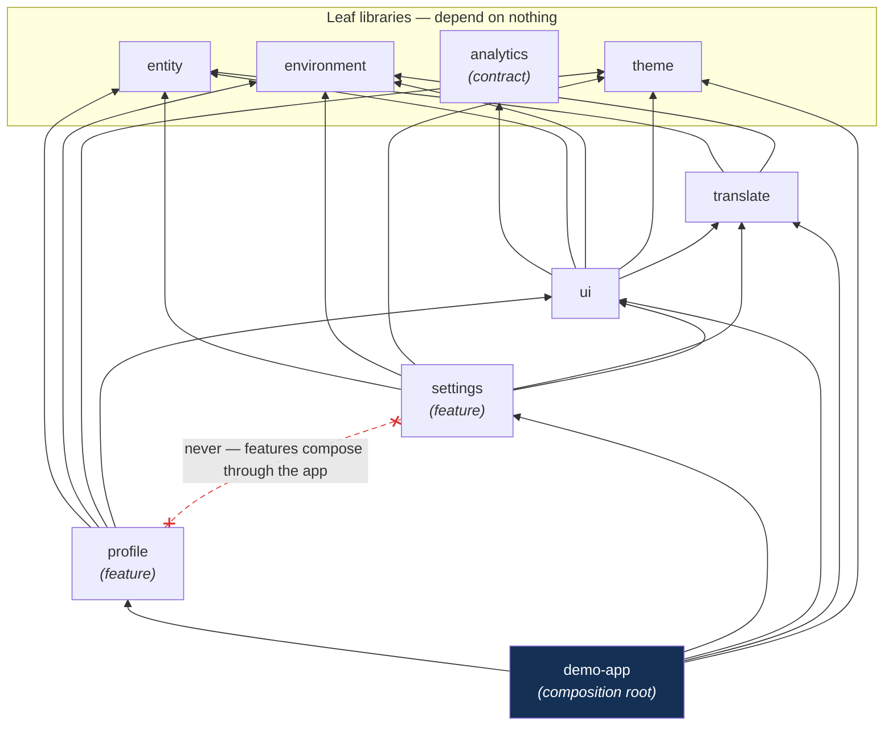
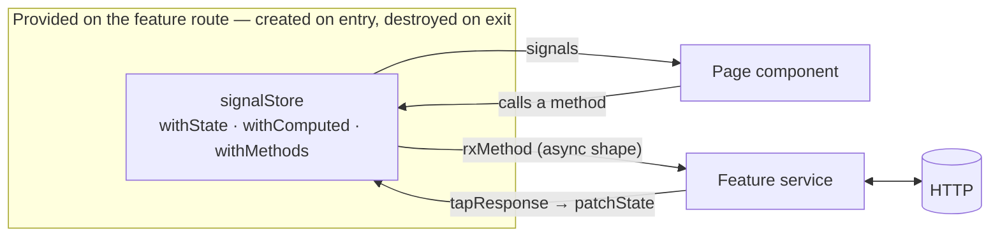

# Architecture

How the workspace is organised and the rules that keep it that way. Day-to-day rules for
contributors and agents are in [`AGENTS.md`](../AGENTS.md); coding standards in
[`best-practices.md`](best-practices.md).

## Layout

```
apps/demo-app/            The Angular app: routes, pages (home, not-found), shell wiring, demo brand JSON
libs/
  environment/            Build-time environment files and API path constants
  theme/                  Design tokens, ThemeService (light/dark), BrandThemeService (demo brands)
  profile/  settings/     Feature libraries
  shared/
    ui/                   Atoms, molecules, organisms, ViewportService, error handling
    translation/          i18n setup and language switching
    analytics/            ANALYTICS contract and NoopAnalytics
    entity/               Shared models
tools/                    Secrets check and the workspace generator plugin
docs/                     This folder
```

## Mock API

`functions/api/[[path]].ts` is a Cloudflare Pages Function that answers `/api/*`
from a table of `METHOD /path` handlers. It is the only mock: locally,
`wrangler pages dev` serves it next to the production bundle (the e2e suite runs
on exactly this stack), and in production it is deployed unchanged. Pages
Functions are matched before `_redirects`, so the SPA fallback never shadows the
mock, and an unmatched `/api` call returns a 404 JSON — a missing mock is loud.
Features keep calling `HttpClient` against same-origin `/api` URLs, so a real
Worker or backend later means replacing the function, not changing features.

## Theming

fungular ships **no design-system constraints** by design, but it does demonstrate
runtime theming twice over:

- **Light/dark** — `ThemeService` toggles `data-theme` plus the `dark` class,
  following the OS by default. The dark palette (`_themes.scss`) is enabled; it
  restyles surfaces, text and status colours while keeping the neutral scale.
- **Demo brands** — `BrandThemeService` fetches one of three fictional brands
  (`assets/brands/{solstice,harbor,meadow}.json`), validates every value, and sets
  the brand's `--color-*` tokens as inline variables on `<html>`. Inline styles
  beat the stylesheet, and brands only own the *brand* family of tokens
  (`brand`, `brand-hover`, `brand-subtle`, `accent`, `link`, `progress`), so
  surfaces and text stay theme-controlled and brands read identically in light
  and dark. `?brand=` picks the brand at startup; the home page switches it live;
  the JSON is the swap point for a real branding source later.

### Library Tags and Dependency Rules

Every arrow below is an allowance the linter enforces; anything not allowed fails
the build (the table underneath is the exact allow-list). The red dashed line is
the rule that keeps the workspace deletable: features never see each other.



Defined in `eslint.base.config.mjs` — the file every project's `eslint.config.mjs`
extends. (The root `eslint.config.mjs` applies to workspace-level files only; rules
placed there would never run for a project.)

| Tag                     | May depend on                                    | Purpose                             |
| ----------------------- | ------------------------------------------------ | ----------------------------------- |
| `scope:entity-lib`      | _nothing_                                        | Data models and interfaces          |
| `scope:environment-lib` | _nothing_                                        | Environment configuration           |
| `scope:theme-lib`       | _nothing_                                        | Design tokens and `ThemeService`    |
| `scope:analytics-lib`   | _nothing_                                        | The `ANALYTICS` contract            |
| `scope:translate`       | entity, environment                              | i18n setup, language switching      |
| `scope:profile`         | entity, environment, theme, ui                   | Profile feature                     |
| `scope:settings`        | entity, environment, theme, translate, ui        | Settings feature                    |
| `scope:ui-lib`          | analytics, entity, environment, theme, translate | Presentational + cross-cutting UI   |
| `scope:demo-app`        | all of the above                                 | The application composes everything |

Two rules worth naming, because they are what the table is _for_:

- **Features cannot see each other.** `scope:profile` and `scope:settings` have no
  entry for one another, so a shortcut import between them fails lint. Features
  compose through the app.
- **Vendors stay behind the contract.** Picking an analytics vendor is a
  composition decision, so it would happen once, in `app.config.ts`. Libraries depend on
  `scope:analytics-lib` — the contract — and never learn which implementation is
  behind it.

### Atomic Design (component organization)

```
atoms/       → Basic elements — libs/shared/ui/src/lib/atoms/ (button, badge, banner, progress, avatar, icon …)
molecules/   → Combinations of atoms — libs/shared/ui/src/lib/molecules/ (list-row, breadcrumb …)
organisms/   → Complete structures — libs/shared/ui/src/lib/organisms/ (shell, shell-header, shell-nav …)
pages/       → Route-level components — apps/demo-app/src/app/pages/ and <feature>/src/lib/pages/
```

Shared atoms, molecules and organisms live in `@libs/ui` and are presentational: they
take `input()`s and emit `output()`s, and never import a feature. A component that only
one feature uses stays in that feature until a second consumer exists, so the shared
lib does not become a junk drawer. The shell takes its navigation from the app for the
same reason.

### Design-system Storybook

Every `@libs/ui` component has a colocated story (`*.stories.ts`) — open a
component, change its inputs in the Controls panel, and use the three toolbar
switches to test it visually:

- **Brand** — applies one of the three demo brands (Solstice, Harbor, Meadow) by
  loading its JSON and setting the brand CSS variables, exactly as the app does at
  startup. App shell stories read it from the `loaded.brand` loader.
- **Theme** — flips the tokens between light and dark via `data-theme`,
  the same attribute `ThemeService` drives in the app.
- **Direction** — flips `dir` between LTR and RTL, which is what Arabic renders
  under.

```sh
npx nx storybook ui        # local, http://localhost:4400
npx nx build-storybook ui  # static build (runs in CI on every PR)
```

Storybook runs on the Vite-based `@storybook/angular-vite` framework (preview status until
Storybook 11), so the Webpack builder is not in the tree. Vite ignores tsconfig `paths`, so
`.storybook/main.ts` turns the `tsconfig.base.json` `paths` into `resolve.alias` entries.

Stories use the app's real i18n bundles and self-hosted fonts (served via
`staticDirs`, not imported — the module boundaries stay intact). CI builds the
catalogue on every PR, so a broken story fails before merge. Conventions for
writing stories live in
[`.claude/skills/storybook/`](.claude/skills/storybook/SKILL.md).

### State Pattern

No actions, no reducers, no selector files — a feature's state is a
`signalStore` the component talks to directly, and the async path goes through
`rxMethod` + `tapResponse`:



**Feature state is a `signalStore`**, provided on its route:

```
libs/<feature>/src/lib/
├── +state/
│   └── <feature>.store.ts     # withState · withComputed · withMethods
└── pages/
    └── <feature>.routes.ts    # providers: [<Feature>Store, <Feature>Service]
```

The global NgRx Store carries **router state and nothing else**. Features do not add
slices to it. See [`.claude/skills/ngrx-state/SKILL.md`](.claude/skills/ngrx-state/SKILL.md).

Two feature libraries show the two shapes a feature takes:

|                 | `@libs/profile`                                 | `@libs/settings`                                                                                  |
| --------------- | ----------------------------------------------- | ------------------------------------------------------------------------------------------------- |
| Data            | HTTP via a service                              | none — local and synchronous                                                                      |
| Store           | `rxMethod` + `tapResponse`, loading/error state | plain methods, `withHooks` on entry                                                               |
| Owns its state? | yes                                             | no — forwards to `ThemeService` / `UpdateLanguageService` and exposes them through `withComputed` |

That last row is the one people get wrong. Theme and language already live in
services as signals; copying them into `withState` creates a second source of truth
that goes stale the moment the header changes the language.

### Analytics

Nothing outside a vendor's own library knows which analytics vendor is in use.

```ts
// Anywhere: inject the contract.
private readonly analytics = inject(ANALYTICS);

// app.config.ts: choose an implementation, once.
{ provide: ANALYTICS, useClass: YourAnalytics },
```

Without a registered implementation `ANALYTICS` resolves to `NoopAnalytics`, so call
sites need no `if (analytics)` guard and no vendor SDK is bundled. See
[`.claude/skills/analytics/SKILL.md`](.claude/skills/analytics/SKILL.md).

### Testing

| Layer      | Tool               | Covers                                                             |
| ---------- | ------------------ | ------------------------------------------------------------------ |
| Unit       | Vitest + Spectator | Stores, services, components                                       |
| End-to-end | Playwright         | Routing, lazy chunks, persistence, `<html lang>`, accessible names |

Unit tests run through Angular's official `@angular/build:unit-test` builder with
Vitest as the runner. Each project sets its own coverage floor in the `test` target
of its `project.json`, just under what it measures today. One caveat to keep in
mind: coverage is measured from the compiled test bundle, so a file no spec (or
route) imports is invisible to the report rather than dragging the number down.

The e2e suite runs against `nx serve` in CI. Set `BASE_URL` and the same specs run
against a deployed build instead, which is the only way to exercise production
optimisation, hashed assets and hosting rewrites.

### Internationalisation

Eight bundles live in `apps/demo-app/src/assets/i18n/` — `en`, `nl`, `fr`, `pt`,
`es`, `de`, `ar`, `pl`. `provideTranslation()` wires the loader, restores the
language from `localStorage`, keeps `<html lang>` and `<html dir>` in sync (Arabic
renders right-to-left) and translates each route's `<title>`.

Adding a language means adding it to the `Language` enum and dropping in the JSON
bundle — `i18n-completeness.spec.ts` fails until every key is present in every
language, so bundles cannot drift.

## Code standards

Short version in [`AGENTS.md`](../AGENTS.md); the full guide in [`best-practices.md`](best-practices.md).
